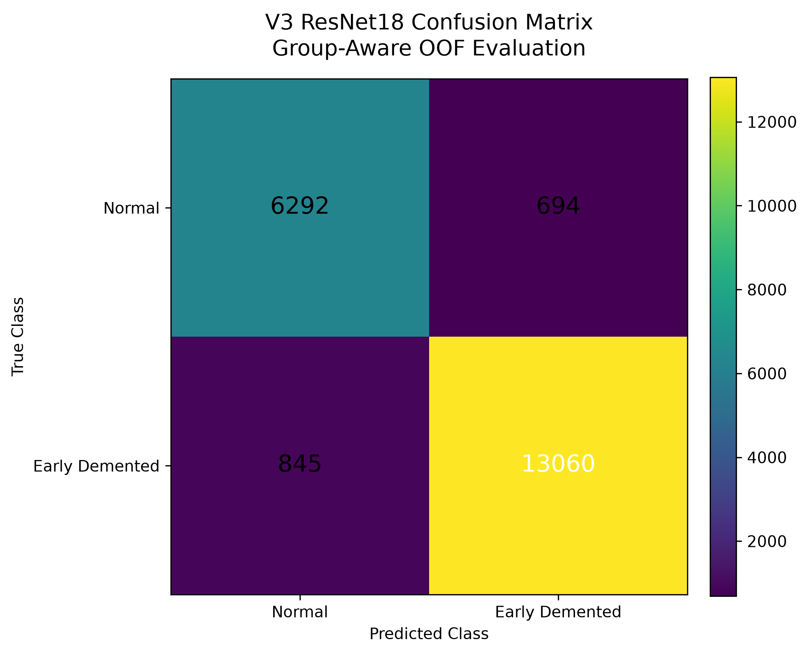
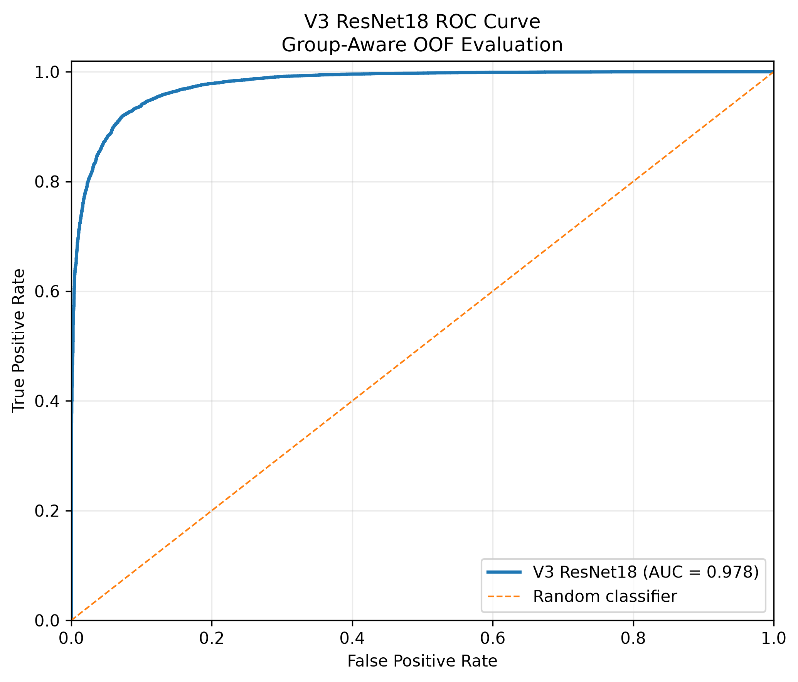
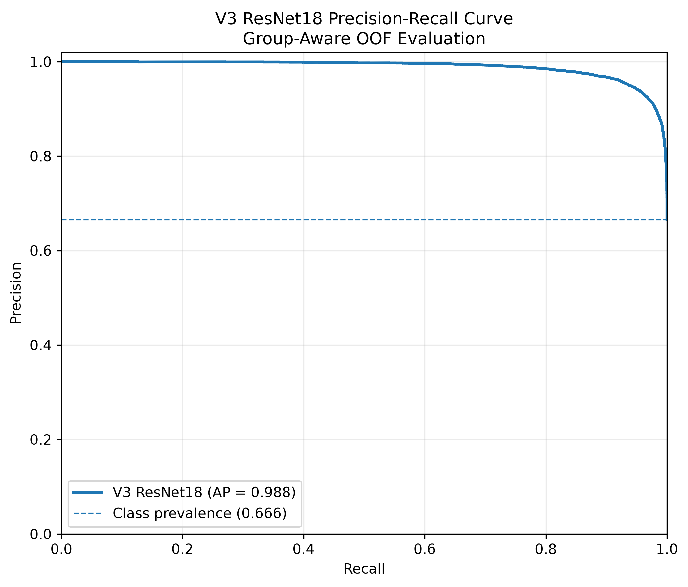
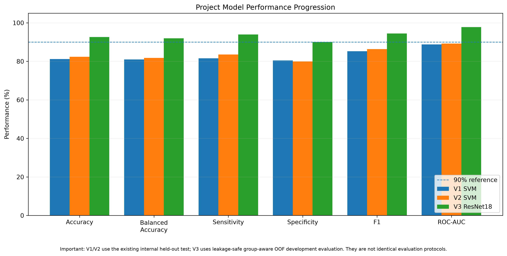

# Early Detection of Alzheimer's Disease Using Machine Learning and Deep Learning

**Biomedical Engineering Graduation Project**

A machine-learning and deep-learning framework for the early detection of Alzheimer's disease from brain MRI images.

The project investigates classical machine-learning approaches and transfer learning using convolutional neural networks, with particular emphasis on leakage-aware evaluation, early-stage dementia detection, reproducibility, and cross-dataset generalization.

---

## Project Overview

Alzheimer's disease is a progressive neurodegenerative disorder in which early identification is important for patient monitoring and intervention planning.

This project develops an MRI-based classification pipeline for distinguishing:

- **Normal**
- **Early Demented**

The primary binary classification task was defined as:

```text
NonDemented
      ↓
    Normal

VeryMildDemented
        +
MildDemented
      ↓
Early_Demented
```

`ModerateDemented` cases were excluded from the primary early-detection task.

---

## Primary Model

The final primary model is an **ImageNet-pretrained ResNet18** transfer-learning model.

### V3 ResNet18 Performance

Performance was measured using leakage-aware, group-aware out-of-fold evaluation on the locked V3 development dataset.

| Metric | Performance |
|---|---:|
| Accuracy | **92.633%** |
| Balanced Accuracy | **91.994%** |
| Sensitivity | **93.923%** |
| Specificity | **90.066%** |
| Precision | **94.954%** |
| F1 Score | **94.436%** |
| ROC-AUC | **97.785%** |
| PR-AUC | **98.839%** |
| Matthews Correlation Coefficient | **0.8355** |

### Early-stage subgroup performance

| Subgroup | Performance |
|---|---:|
| Very Mild Demented sensitivity | **90.076%** |
| Mild Demented sensitivity | **97.782%** |
| Non-Demented specificity | **90.066%** |

> **Important:** These V3 values represent leakage-safe group-aware out-of-fold development performance. They should not be interpreted as independent external clinical validation.

---

## Confusion Matrix



The V3 confusion matrix contains:

```text
TN = 6292
FP = 694
FN = 845
TP = 13060
```

---

## ROC Curve



The ResNet18 model achieved:

**ROC-AUC = 0.97785**

indicating strong discrimination between the two target classes within the primary MRI data domain.

---

## Precision-Recall Curve



The model achieved:

**PR-AUC = 0.98839**

which indicates strong precision-recall performance for the Early_Demented class.

---

## Model Development

Three major model generations were investigated.

### V1 — Classical Machine Learning

The first model used an RBF Support Vector Machine operating on 30 engineered MRI features.

Frozen internal test performance included approximately:

- Accuracy: **81.2%**
- Balanced Accuracy: **81.0%**
- ROC-AUC: **88.8%**
- PR-AUC: **92.9%**

---

### V2 — Optimized SVM

The second model used group-aware cross-validation for hyperparameter selection.

The selected configuration used:

```text
Kernel:       RBF
C:            50
Gamma:        0.06
Class weight: balanced
```

Its internal test performance improved to approximately:

- Accuracy: **82.4%**
- Balanced Accuracy: **81.8%**
- Sensitivity: **83.6%**
- F1: **86.3%**
- ROC-AUC: **89.2%**

---

### V3 — ResNet18 Transfer Learning

The final primary model used a pretrained ResNet18.

Training was performed in two stages:

1. Train the classifier head while freezing the convolutional backbone.
2. Unfreeze `layer4` and the classifier head for fine-tuning.

The architecture produced a substantial improvement over the classical ML approaches.



> V1/V2 and V3 use different evaluation protocols.  
> The comparison figure represents model-development progression and should not be interpreted as a perfectly controlled head-to-head test.

---

# Dataset

The original project dataset contained:

**39,538 brain MRI images**

across four original categories:

| Original Class | Images |
|---|---:|
| NonDemented | 9,984 |
| VeryMildDemented | 9,983 |
| MildDemented | 9,886 |
| ModerateDemented | 9,685 |
| **Total** | **39,538** |

For the primary early-detection task:

```text
Normal          = NonDemented
Early_Demented  = VeryMildDemented + MildDemented
```

This produced **29,853 images** for the primary binary task.

---

# Data Leakage Control

Preventing leakage was treated as an important part of the project.

The project included:

- duplicate-image checks
- leakage-group construction
- group-aware splitting
- zero group overlap between train, validation, and test splits
- group-aware cross-validation for V3
- model freezing before later challenge evaluations

The primary dataset was divided into:

| Split | Images |
|---|---:|
| Training | 20,891 |
| Validation | 4,482 |
| Test | 4,480 |
| **Total** | **29,853** |

---

# MRI Preprocessing

The image preprocessing pipeline included:

```text
MRI Image
   ↓
Grayscale conversion
   ↓
Aspect-preserving resize
   ↓
Black padding to 220 × 220
   ↓
CLAHE contrast enhancement
   ↓
3 × 3 median filtering
   ↓
CNN input preparation
   ↓
224 × 224 ResNet18 input
```

For the ResNet18 model, grayscale images were duplicated into three channels and normalized using ImageNet normalization statistics.

---

# V3 Training Strategy

The V3 model was trained using a three-fold group-aware cross-validation strategy.

### Stage 1

```text
Frozen ResNet18 backbone
        ↓
Train classifier head
        ↓
3 epochs
Learning rate = 1e-3
```

### Stage 2

```text
Unfreeze layer4
        +
classifier head
        ↓
3 epochs
Learning rate = 1e-4
```

Additional settings included:

- AdamW optimizer
- class-weighted cross entropy
- small MRI-safe augmentation
- no horizontal flipping
- fixed random seed
- CPU-compatible training pipeline

---

# Decision Threshold

The final V3 decision threshold was selected using only leakage-safe out-of-fold development predictions.

```text
Threshold ≈ 0.48834
```

The threshold was frozen before subsequent evaluation experiments.

No threshold tuning is performed during prediction.

---

# Prediction Demo

The project includes a command-line prediction tool:

```text
src/v3/final_primary_v3_predict.py
```

Example:

```powershell
python src/v3/final_primary_v3_predict.py "MRI_IMAGE.png"
```

Example output:

```text
Prediction: Early_Demented

Model score: 99.99%

Normal probability: 0.01%
Early Demented probability: 99.99%
```

The reported model score is the neural-network output for the individual image and is **not equivalent to guaranteed diagnostic accuracy**.

---

# Cross-Dataset Generalization Study

An additional evaluation was conducted using MRI data from the **OASIS** dataset.

This experiment was intentionally separated from the primary V3 development performance.

The study revealed substantial distribution differences between the primary MRI dataset and OASIS, including differences in:

- brain spatial coverage
- image intensity distributions
- non-zero brain area
- bounding-box geometry
- image entropy
- edge density

Performance decreased substantially on previously unseen OASIS cases.

This indicates that strong performance within one MRI data domain does not automatically guarantee equivalent performance across scanners, acquisition protocols, or datasets.

The OASIS experiment is therefore presented as a **cross-domain generalization and domain-shift study**, not as the primary project performance result.

---

# Key Findings

The main findings of the project are:

1. Classical machine-learning methods provided a useful baseline but had limited performance for early-stage classification.

2. Transfer learning using ResNet18 substantially improved classification performance.

3. The V3 model achieved more than 90% on all primary percentage-based metrics in leakage-aware group-aware development evaluation.

4. Very mild dementia remained more difficult than mild dementia.

5. High internal performance did not automatically transfer to a different MRI domain.

6. Dataset and scanner domain shift is therefore an important limitation for real-world Alzheimer's MRI classification.

---

# Project Structure

```text
Alzheimer-Early-Detection/
│
├── README.md
├── requirements.txt
├── .gitignore
│
├── src/
│   ├── v1_v2/
│   │   ├── v2_svm_group_cv_tuning.py
│   │   ├── v2_validation_threshold_selection.py
│   │   ├── freeze_v2.py
│   │   ├── final_v2_test_evaluation.py
│   │   └── reproduce_final_v1.py
│   │
│   └── v3/
│       ├── v3_prepare_cnn_dataset.py
│       ├── v3_resnet18_baseline.py
│       ├── v3_oof_threshold_optimization.py
│       ├── train_freeze_v3_final_fixed.py
│       ├── final_primary_v3_predict.py
│       └── build_final_v3_results_package.py
│
├── results/
│   ├── v3_confusion_matrix.png
│   ├── v3_roc_curve.png
│   ├── v3_precision_recall_curve.png
│   ├── v1_v2_v3_comparison.png
│   └── final_v3_primary_metrics.csv
│
├── models/
├── docs/
└── demo/
```

---

# Installation

Python 3 is required.

Install the primary dependencies using:

```bash
pip install numpy pandas matplotlib scikit-learn opencv-python pillow torch torchvision
```

Or install from:

```bash
pip install -r requirements.txt
```

---

# Reproducibility

The project uses:

- fixed random seeds
- group-aware splitting
- frozen model configurations
- frozen thresholds
- stored model configurations
- SHA-256 model integrity checks

These measures were used to reduce accidental leakage and uncontrolled model changes during evaluation.

---

# Limitations

Important limitations include:

- The primary model is based on 2D MRI images rather than complete 3D MRI volumes.
- Performance may decrease on MRI scans from different scanners or acquisition protocols.
- Cross-dataset OASIS experiments demonstrated substantial domain shift.
- Model probabilities should not be interpreted as calibrated clinical probabilities.
- The project is not intended for clinical decision-making.
- Further patient-level multi-center validation would be required before any clinical application.

---

# Future Work

Possible future improvements include:

- 3D CNN architectures
- volumetric MRI analysis
- multi-slice patient-level inference
- larger multi-center datasets
- domain adaptation
- scanner harmonization
- calibrated uncertainty estimation
- explainable AI methods
- longitudinal MRI analysis
- prospective clinical validation

---

# Research Disclaimer

This project was developed for **academic and research purposes** as a Biomedical Engineering graduation project.

It is **not a medical device** and must not be used as a substitute for professional medical diagnosis or clinical decision-making.

---

## Final Primary Result

> **ResNet18 V3 — 92.63% Accuracy, 97.79% ROC-AUC, 98.84% PR-AUC**

under leakage-aware group-aware out-of-fold evaluation of the primary MRI dataset.